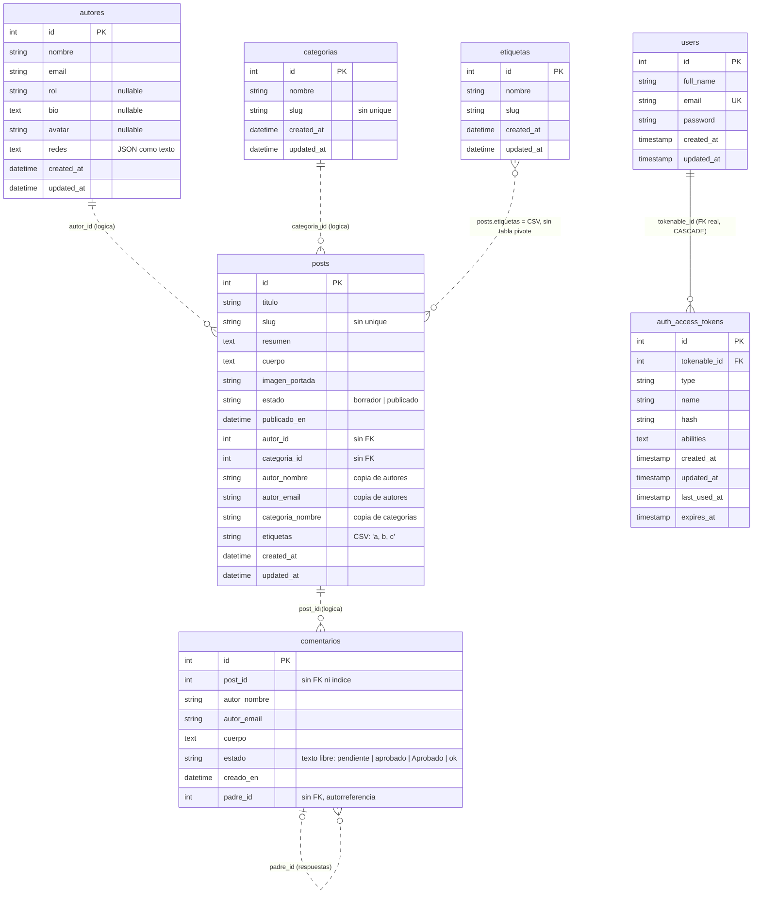

# DER de la base de datos (SQLite)

Sacado de las migraciones en `backend/database/migrations/`. Línea **punteada** = relación
lógica que **no existe como clave foránea** en la base. Línea **continua** = FK real.

## Cómo leerlo

- **Bloque del blog** (`autores`, `categorias`, `etiquetas`, `posts`, `comentarios`): ninguna
  relación tiene FK. Todas las uniones dependen de que la aplicación mantenga los ids bien.
- **`posts` guarda copias** de datos de otras tablas (`autor_nombre`, `autor_email`,
  `categoria_nombre`), que pueden quedar desactualizadas.
- **`etiquetas` ↔ `posts`** es N:M, pero se resolvió con una cadena separada por comas en
  `posts.etiquetas` en lugar de una tabla pivote.
- **`comentarios`** se une a su post por `post_id` y a su comentario padre por `padre_id`
  (respuestas de un nivel), ambos sin FK ni índice. Ver hallazgos #8 y #13 de
  [`comentarios.md`](comentarios.md).
- **Bloque de autenticación** (`users`, `auth_access_tokens`): es el único con FK real, y no
  tiene relación con el blog. Un autor del blog (`autores`) no es un `user`.
